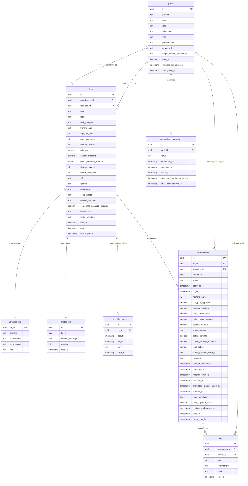

# Diagramme ERA : base de données Supabase de Mini Vadrouille

Ce diagramme décrit les 8 tables du schéma `public` de la base Supabase. Il a été établi à partir du fichier généré `src/integrations/supabase/types.ts` (tables, colonnes, clés étrangères, énumérations).

Lecture des liens :
- `||--o{` : un-à-plusieurs (un profil possède plusieurs kits).
- `||--||` : un-à-un (un kit a une seule adresse).
- Les clés étrangères sont notées `FK`, les clés primaires `PK`.

## Valeurs possibles des champs à choix (énumérations)

| Champ | Valeurs |
|---|---|
| `profils.role` | `client`, `vendeur`, `admin` |
| `kits.tranche_age` | `petit_cocon`, `explorateur_curieux`, `mini_baroudeur` |
| `kits.disponibilite` | `disponible`, `en_reparation` |
| `kits.statut_relecture` | `en_attente_relecture`, `publie`, `refuse` |
| `reservations.statut` | `en_attente`, `acceptee`, `refusee`, `expiree`, `annulee_par_locataire`, `annulee_par_loueur` |
| `reservations.statut_caution` | `encaissee`, `remboursee`, `retenue` |
| `avis.sens` | `locataire_vers_loueur`, `loueur_vers_locataire` |
| `demandes_suppression.statut` | `recue`, `en_attente_fin_reservation`, `traitee` |

## Points à confirmer dans le tableau de bord Supabase

- `profils.id` est probablement lié à la table d'authentification `auth.users` de Supabase Auth. Ce lien n'apparaît pas dans `types.ts` (qui ne décrit que le schéma `public`), il est donc à vérifier avant l'oral.
- Les politiques RLS (Row Level Security) de chaque table ne sont pas visibles dans ce fichier : elles sont décrites dans [RLS.md](RLS.md), à confirmer avec le tableau de bord Supabase (Authentication, puis Policies).
- Les types SQL exacts (`uuid`, `timestamptz`, `numeric`) sont déduits des types TypeScript : à confirmer dans le Table Editor.
